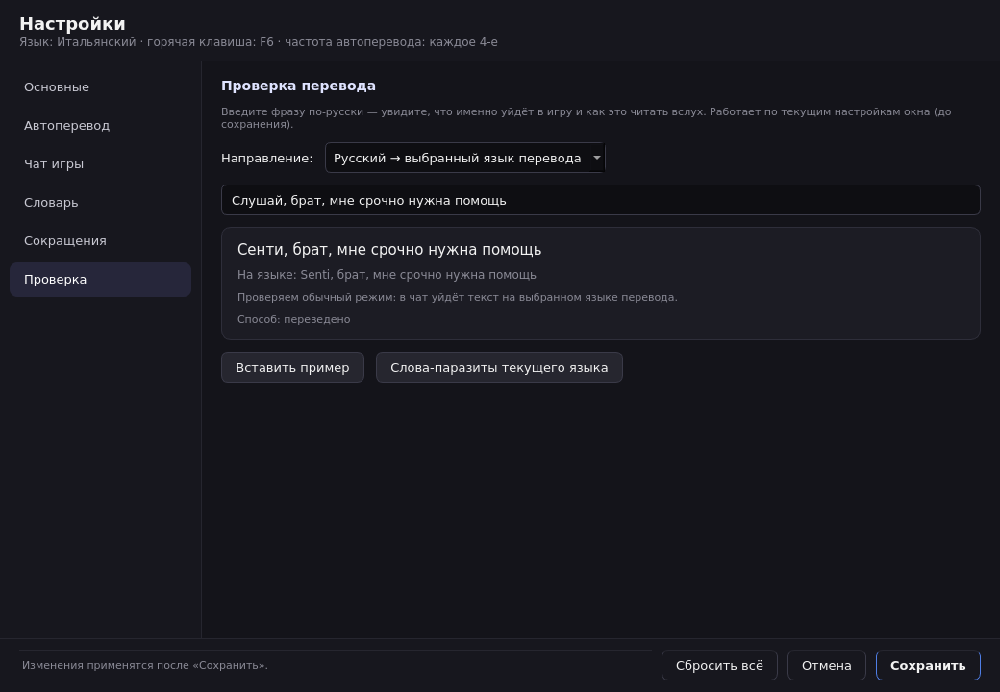

# 🎮 RP Chat Overlay — переводчик чата для GTA V / FiveM


Печатаете по-русски — в чат игры уходит фраза на выбранном языке.
Оверлей сначала открывает чат игры (**T**), чтобы окружающие видели, что вы пишете,
затем показывает окно перевода и отправляет текст. Работает и в обратную сторону:
для иностранного игрока на русскоязычном сервере — пишете на своём, в чат уходит русский.

**Весь функционал кратко:** перевод в обе стороны · 13 языков · словарь и свои фразы ·
180 сокращений (`brb`, `afk`, `gg`, `спс`) · свои сокращения и слова-паразиты ·
автоперевод по счётчику и по маркерам `+…+` · действия `*…*` · отправка прямо в чат игры ·
интерфейс на русском и английском · адаптивное окно с масштабом · проверка перевода
в обе стороны · несколько сервисов перевода с подменой при занятости.

> 📌 Изменения по версиям: **[CHANGELOG.md](CHANGELOG.md)** (на русском и английском).

---

# ✅ ГОТОВЫЙ EXE УЖЕ ЛЕЖИТ В ПАПКЕ `dist`

> ### 📦 `dist/RPChatOverlay.exe` — 37,4 МиБ, запускайте двойным кликом
>
> | | |
> |---|--|
> | **Что сделать** | Скачать папку `dist` и запустить `RPChatOverlay.exe` |
> | **Что устанавливать** | **Ничего** — Python, PySide6 и все библиотеки внутри exe |
> | **Первый запуск** | Рядом появятся `data\` (настройки и словари) и `logs\` (журнал) |
> | **Сборка** | версия **1.5** · Python 3.12.8 · PySide6 6.8.1 · PyInstaller 6.22 · onefile |
> | **MD5** | `99648a90c173504c9b95ce6794748319` |
> | **VirusTotal** | [отчёт по SHA-256](https://www.virustotal.com/gui/file/47d81b8109ff9a926571508b7437e1b8765dd66e6504f6500584bad92ac2e3fb) |
>
> Папка **`source/`** нужна только для разработки и пересборки — игрокам её передавать не обязательно.
> Подробности про файл: **`dist/ЧИТАЙ_МЕНЯ.txt`** (или `dist/READ_ME.txt` — то же самое латиницей:
> некоторые архиваторы показывают кириллические имена как `╨з╨Ш╨в╨Р╨Щ_╨Ь╨Х╨Э╨п`, это одно и то же).

> ⚠️ **Антивирус / «Не удалось проверить издателя»** — exe не подписан, это обычная реакция
> на PyInstaller: «Подробнее» → «Выполнить в любом случае». Если файл удаляется — добавьте папку в исключения.
>
> 🛡 **Отчёт VirusTotal по этой сборке** (SHA-256 `47d81b81…e3fb`):
> [virustotal.com/gui/file/47d81b81…e3fb](https://www.virustotal.com/gui/file/47d81b8109ff9a926571508b7437e1b8765dd66e6504f6500584bad92ac2e3fb) — постоянная ссылка на файл,
> а не на отдельный анализ, поэтому всегда открывает свежий отчёт.

---

## 🧩 Что умеет программа

| Возможность | Как это выглядит на практике |
|---|---|
| **Перевод из русского** | `привет, брат` → `Ciao, fratello` — выбранный язык уходит в чат игры |
| **Режим для иностранного игрока** | пишете на своём языке — в чат уходит русский перевод, целиком, вместе с `*действиями*` |
| **13 языков перевода** | итальянский, испанский, мексиканский, pt-BR, китайский, японский, английский, немецкий, французский, польский, турецкий, корейский, арабский |
| **Словарь** | 100+ готовых фраз со своей русской записью («как это читается вслух») и русскими значениями; свои фразы, импорт JSON/CSV, экспорт |
| **Сленг и сокращения** | 180 сокращений плюс растянутый смех (`looool`, `xD`, `kek`), 31 русское: «brb» → «I'll be right back» → «я скоро вернусь»; «спс» → «спасибо» |
| **Свои сокращения** | раздел как у словаря: сокращение · разворот · русский вариант, «★» перекрывает встроенное, пустые колонки выключают |
| **Автоперевод** | каждое N-е сообщение, доля текста, приоритет словаря; `/to /lto /l /wt /s /st` считаются наравне с обычными сообщениями |
| **Маркеры `+…+`** | принудительный перевод фрагмента, даже когда автоперевод выключен |
| **Действия `*…*`** | переводятся целиком, служебные команды `/me`, `/do`, `/to` и ники — нет |
| **Слова-паразиты** | `Senti`, `Ma dai`, `Oye`, `那个` — в **каждом** сообщении, независимо от счётчика |
| **Отправка в игру** | чат открывается сам (`T`), текст вставляется и отправляется по Enter; три настраиваемые задержки |
| **Язык интерфейса** | при первом запуске выбор **Русский / English**, меняется в настройках сразу, без перезапуска |
| **Адаптивное окно** | размер подгоняется под экран (не больше 94 % рабочей области), разделы прокручиваются, масштаб 80–180 % |
| **Проверка перевода** | оба направления, «Русский → выбранный язык перевода» и «Ваш язык → русский»: видно, что именно уйдёт в чат |
| **Несколько сервисов перевода** | Google gtx → Google clients5 → Google web → MyMemory → Lingva → LibreTranslate: если один ответил «429», берётся следующий |
| **Трей** | четыре строки: статус, направление перевода, «Настройки…», «Выход»; двойной клик — оверлей |

---

## 📁 Структура проекта

```
italian-overlay/
├─ dist/                          ← ГОТОВАЯ ПРОГРАММА
│  ├─ RPChatOverlay.exe           ← запускать это (37,4 МиБ)
│  ├─ ЧИТАЙ_МЕНЯ.txt              ← инфо о файле: размер, MD5, сборка
│  └─ READ_ME.txt                 ← тот же текст, имя латиницей (для старых архиваторов)
│
├─ source/                        ← исходники и сборка
│  ├─ main.py                     ← точка входа (--settings, --selftest, --find-game, --langs)
│  ├─ settings_ui.py              ← окно настроек (разделы в прокрутке, масштаб)
│  ├─ overlay.py                  ← оверлей: чат игры → окно → отправка
│  ├─ engine.py                   ← маркеры, действия, словарь, автоперевод, паразиты
│  ├─ gamesend.py                 ← окно GTA, фокус, открытие/закрытие чата, ввод
│  ├─ translator.py               ← цепочка сервисов перевода и кэш
│  ├─ slang.py                    ← 180 сокращений и свои записи игрока
│  ├─ i18n.py · ui_lang.py        ← русский/английский интерфейс и окно первого запуска
│  ├─ translit.py                 ← русская запись по звучанию
│  ├─ langs.py · langpacks/       ← 13 языков и встроенные словари
│  ├─ glossary_data.py            ← итальянский словарь (103 фразы)
│  ├─ autoplan.py · hotkey.py · common.py
│  ├─ start.bat                   ← запуск из исходников (сам ставит Python и библиотеки)
│  ├─ build_exe.bat               ← сборка exe → ../dist/RPChatOverlay.exe
│  ├─ RPChatOverlay.spec          ← пресет PyInstaller
│  ├─ requirements.txt · icon.ico · icon.png
│  └─ images/                     ← картинки для этого README и для темы на форуме
│
├─ .github/workflows/build-windows.yml   ← сборка exe в облаке GitHub
├─ CHANGELOG.md                   ← история версий (RU + EN)
├─ .gitignore · .gitattributes
└─ README.md
```

Запуск из исходников: `source\start.bat` (если `dist\RPChatOverlay.exe` уже есть — он просто откроет его).
Сборка exe: `source\build_exe.bat` → результат **всегда** в `dist\`.

---

## 🚀 Быстрый старт

| Шаг | Действие |
|:---:|----------|
| **1** | Запустите `dist\RPChatOverlay.exe` |
| **2** | На первом запуске выберите язык интерфейса, затем язык перевода и горячую клавишу → **Сохранить** |
| **3** | В игре: **F6** → печатаете по-русски → **Enter** → текст улетает в чат |

> 💡 **Esc** — отмена: закрываются и оверлей, и пустой чат игры.
> ⚠️ Если игра запущена от администратора — программу тоже запускайте от администратора.

---

## 🖼 Как это выглядит





---

## ⚙️ Окно настроек

Открывается при запуске (можно отключить) и из меню трея → **«Настройки…»**.
В меню трея всего четыре строки: статус переводчика, направление перевода,
**«Настройки…»** и **«Выход»** — всё остальное настраивается в этом окне.
Двойной клик по значку в трее открывает оверлей.
Слева разделы, справа параметры; подсказка есть у каждого поля; изменения применяются по кнопке **«Сохранить»**.

| Раздел | Что настраивается |
|--------|-------------------|
| 🧩 **Основные** | Язык перевода · «что уходит в чат» (русская запись или текст на языке) · **язык интерфейса** · горячая клавиша с ловлей нажатия · открывать окно при запуске · **масштаб интерфейса 80–180 %** · скобки перевода · лимит символов · задержка перевода · **раскрытие сленга и сокращений** |
| 🔁 **Автоперевод** | включение · частота «каждое N-е» · какое сообщение в серии · число и длина фрагментов · приоритет словаря · **слова-паразиты «всегда»** + их список |
| 🎮 **Чат игры** | вставлять в чат · **сначала открывать чат (T)** · отправлять сразу (Enter) · клавиша чата · три задержки |
| 📚 **Словарь** | таблица «фраза · русская запись · русские значения» с поиском · добавить/удалить · **Импорт JSON/CSV** · **Экспорт** · вернуть встроенный словарь |
| ★ **Сокращения** | свои сокращения по образцу словаря: сокращение · разворот · русский вариант · поиск · импорт/экспорт · вернуть встроенные |
| 🔍 **Проверка** | живой предпросмотр в обе стороны: «Русский → выбранный язык перевода» и «Ваш язык → русский» — видно, что именно уйдёт в чат игры |

Окно подстраивается под экран: на 1366×768 оно занимает не больше 94 % рабочей области,
разделы прокручиваются, а масштаб шрифта и отступов задаётся ползунком **Масштаб интерфейса**.

---

## 🔄 Режим для иностранного игрока

Для тех, кто играет на русскоязычном сервере и не говорит по-русски: пишете в оверлее
на своём языке — в чат уходит готовый русский текст.

| | |
|---|---|
| **Где включить** | Настройки → **Основные** → «Переводить на русский»; или меню трея → «Ваш язык → русский» |
| **Что переводится** | всё сообщение целиком, включая действия `*машет рукой*` |
| **Что не переводится** | служебные команды в начале строки (`/me`, `/do`, `/to`, `/l` и прочие) и ник у `/to`, `/lto` |
| **Язык-источник** | определяется автоматически, отдельных настроек не требует |
| **Enter** | отправляет перевод в чат игры — как обычное сообщение |
| **Счётчик автоперевода** | не действует: переводится каждое сообщение |

Порядок работы: **F6** → в игре открывается чат (`T`) → пишете фразу → **Enter** → перевод уходит в чат.

---

## 🌐 Язык интерфейса

При первом запуске программа спрашивает, на каком языке показывать кнопки,
подсказки и меню: **Русский** или **English**. Выбор записывается в конфиг,
а поменять его можно в любой момент: **Настройки → Основные → Язык интерфейса** —
переключение происходит сразу, без перезапуска.

Переведено всё, что видит игрок: окно настроек со всеми разделами, подсказки у
полей, названия языков перевода (`Italian (Italiano)`), меню в трее, строка состояния
оверлея, уведомления и сообщения о сохранении и импорте. Русские тексты остаются
исходными: английский вариант лежит рядом, в таблице `i18n.py`, поэтому оба
языка всегда описывают одно и то же.

---

## 💬 Сленг и сокращения

В живом чате пишут не словами, а сокращениями. Машинный перевод такие токены
либо оставляет латиницей, либо переводит по одной букве — в русской строке
появляется мусор. Программа раскрывает сокращение **до** перевода.

| | |
|---|---|
| **Как работает** | «brb» → «I'll be right back» → «я скоро вернусь»: полная фраза уходит в переводчик, поэтому падеж, род и время получаются верными сами собой |
| **Если сервис вернул латиницу** | подставляется короткий русский вариант: «afk» → «не за клавиатурой», «gg» → «хорошая игра», «idc» → «мне всё равно» |
| **Обратное направление** | русские сокращения раскрываются так же: «спс» → «спасибо», «мб» → «может быть», «пж» → «пожалуйста» |
| **Сколько в таблице** | **180** сокращений и растянутый смех (`looool`, `xD`, `kek`) плюс 31 русское |
| **Где включить** | Настройки → **Основные** → «Разворачивать сленг и сокращения» — включено по умолчанию |

Поддерживаются три пласта: переписка (`ty`, `thx`, `np`, `pls`, `sry`, `tbh`, `ngl`,
`afaik`, `iirc`, `ttyl`, `hmu`, `lmk`, `tyvm`, `wby`, `wdyt`, `nvm`, `idk`, `idc`, `brb`,
`bbs`, `omw`, `gtg`, `cya`, `l8r`, `2moro`, `gr8`, `m8`, `b4`, `w8`…), игры (`gg`, `wp`,
`ez`, `nt`, `gj`, `glhf`, `op`, `pvp`, `pve`, `npc`, `dps`, `xp`, `lvl`, `ult`, `aoe`,
`dc`, `vc`, `inv`, `acc`, `srv`, `wtb`, `wts`, `wtt`, `ff`…) и ролевой отыгрыш (`rp`,
`ooc`, `ic`, `em`, `para`).

Русская колонка подобрана так, чтобы фраза стояла в любом месте предложения:
без рода («не за клавиатурой»), в первом лице без прошедшего времени
(«скоро вернусь», «уже иду») или наречием («кстати», «по-моему»).

### Свои сокращения

Раздел **Настройки → Сокращения** устроен как словарь: таблица «сокращение ·
разворот · русский вариант», поиск, кнопки «Добавить сокращение», «Удалить»,
**«Импорт…»** (JSON или CSV), **«Экспорт…»** и «Вернуть встроенные». Своя строка
помечена «★» и перекрывает встроенную — так можно и переписать `afk` по-своему,
и выключить ненужное сокращение, оставив обе колонки пустыми. Хранится всё в
`data/slang.json`, поэтому настройки переживают перезапуск и переносятся на
другой компьютер одним файлом.

---

## 🌍 Языки

| Код | Язык | Словарь | Паразиты |
|-----|------|:-------:|:--------:|
| `it` | 🇮🇹 Итальянский (Italiano) | 103 | 10 (из PDF) |
| `es` | 🇪🇸 Испанский (Español) | 46 | 7 |
| `es-MX` | 🇲🇽 Мексиканский | 51 | 8 |
| `pt-BR` | 🇧🇷 Португальский (Brasil) | 49 | 8 |
| `zh-CN` | 🇨🇳 Китайский (中文) | 46 | 8 |
| `ja` | 🇯🇵 Японский (日本語) | 40 | 8 |
| `en` | 🇬🇧 Английский (English) | 37 | 8 |
| `de` | 🇩🇪 Немецкий (Deutsch) | 32 | 8 |
| `fr` | 🇫🇷 Французский (Français) | 33 | 9 |
| `pl` | 🇵🇱 Польский (Polski) | 36 | 8 |
| `tr` | 🇹🇷 Турецкий (Türkçe) | 41 | 9 |
| `ko` | 🇰🇷 Корейский (한국어) | сеть | — |
| `ar` | 🇸🇦 Арабский (العربية) | сеть | — |

<details>
<summary><b>Почему именно эти языки</b></summary>

На RP-серверах GTA V за пределами русскоязычного сегмента чаще всего встречаются
английский, бразильский португальский, немецкий, французский, испанский (в том числе
мексиканский), польский, турецкий, арабский; отдельные крупные сообщества — итальянские,
японские, корейские.
</details>

---

## 📚 Свои словари

Раздел **«Словарь» → «Импорт…»**, два формата.

**CSV** (`;`, заголовок можно не писать):

```csv
Фраза;Русская запись;Русские значения
Andiamo;анджамо;пошли; идём; поехали
Che bello;ке белло;как красиво; класс; супер
```

**JSON**:

```json
{"_version": 1, "phrases": {"Andiamo": "анджамо | пошли; идём; поехали"}}
```

> Импорт **дополняет**: новые фразы добавляются, у существующих дописываются значения,
> ваши транскрипции не меняются. Файлы словарей: `data/glossaries/<код>.json` рядом с exe.
> Фразы со звёздочкой **★** — слова-паразиты, переводятся в каждом сообщении.

---

## 🧠 Как это работает

| Приём | Пример | Результат |
|-------|--------|-----------|
| Обычный текст | `привет` | `Чао` (или `Ciao` в режиме «текст на языке») |
| Принудительно | `+привет+` | `Чао` — даже если автоперевод выключен |
| Действие | `*почесал затылок*` | остаётся как есть |
| Автоперевод | `мне срочно нужна Aiutami` | одно сообщение из N |
| Слова-паразиты | `Слушай, брат` | `Сенти, брат` — **в каждом** сообщении |
| Команда с ником | `/to Ivan слушай` | `/to Ivan Сенти` — ник не переводится |

<details>
<summary><b>Счётчик сообщений и команды</b></summary>

`/to`, `/lto`, `/l`, `/wt`, `/s`, `/st` считаются наравне с обычными сообщениями:
двигают серию автоперевода и сами могут переводиться.
`/me`, `/do`, `/b` в счётчик не идут, но `+маркеры+` в них работают.
</details>

<details>
<summary><b>Слова-паразиты по языкам</b></summary>

| Язык | Примеры |
|------|---------|
| Итальянский | Senti · Ma dai · Madonn' · Mannaggia · Capisci? · Che vuoi fare? · Scemo · Agita · Allora · Piano piano |
| Испанский | Oye · ¿Entiendes? · Pues · Joder · Venga · Qué le vamos a hacer · Poco a poco |
| Мексиканский | Órale · No manches · Güey · ¿Mande? · Ni modo |
| Португальский | Ouve · Entendeu? · Então · Tipo · Pô · Nossa · Fazer o quê |
| Китайский | 那个 · 就是 · 你听我说 · 你懂吗 · 没办法 · 慢慢来 |
| Японский | あの · なんか · 聞いて · わかる? · しょうがない · ゆっくり |
| Английский, немецкий, французский, польский, турецкий | по 8–9 фраз |
</details>

<details>
<summary><b>Сервисы перевода и что делать, если Google «занят»</b></summary>

Программа идёт по цепочке и берёт первый ответивший сервис:

`Google gtx → Google clients5 → Google web → MyMemory → Lingva → LibreTranslate`

- у Google два независимых эндпоинта, поэтому ответ «429 Too Many Requests» на одном
  не мешает второму перевести фразу;
- сервис, ответивший «429 / too many requests», выключается на 2 минуты, чтобы не
  тратить время на заведомо занятый адрес;
- на всю цепочку отведено 16 секунд: быстрее показать ошибку, чем держать «перевожу…»;
- MyMemory и LibreTranslate не умеют автоопределение языка, поэтому в режиме
  «ваш язык → русский» работают Google (оба эндпоинта) и Lingva;
- удачные переводы кэшируются в `data/cache.json`, повторная фраза не ходит в сеть;
- без сети и без словаря в чат всё равно можно отправить текст как есть (Enter).
</details>

---

## 🛠 Пересборка exe

```bat
source\build_exe.bat
:: результат: dist\RPChatOverlay.exe
```

Что делает скрипт: находит Python 3.12 → создаёт окружение `source\.build-venv` →
ставит `deep-translator`, `PySide6`, `PyInstaller` → собирает один exe по
`source\RPChatOverlay.spec` → кладёт результат в `dist\`.

<details>
<summary><b>Что учтено в сборке</b></summary>

- `console=False` — окно консоли не появляется, журнал пишется в `logs\app.log`;
- иконка `icon.ico` в exe и в трее;
- `langpacks/*` импортируются статически (иначе PyInstaller не включает модули и exe падает
  с «No module named langpacks.it»);
- `deep_translator` и его зависимости включены;
- лишние модули Qt (QML, WebEngine, Multimedia, Charts, 3D, OpenGL) исключены — поэтому exe «всего» 37 МиБ;
- `data\` и `logs\` создаются рядом с exe; если там нет прав записи (например, `Program Files`) —
  данные уходят в `%LOCALAPPDATA%\RPChatOverlay`.
</details>

---

## ❓ FAQ

<details>
<summary><b>Не удалось проверить издателя / антивирус ругается</b></summary>

Exe не подписан — «Подробнее» → «Выполнить в любом случае», папку добавьте в исключения антивируса.
</details>

<details>
<summary><b>Китайский / японский в чате виден как «???»</b></summary>

Сервер или шрифт игры не поддерживает CJK. Переключите «Что уходит в чат» на **русскую запись** —
в чат уйдёт «Нихао» вместо 你好.
</details>

<details>
<summary><b>Сообщения не появляются в чате</b></summary>

Увеличьте «После открытия чата» до 500–800 мс в разделе **Чат игры**; проверьте, что игра и оверлей
запущены с одинаковыми правами.
</details>

<details>
<summary><b>Перевод не идёт, в окне «Проверка» ошибка</b></summary>

Скорее всего все сервисы заняты или нет сети. Проверка подсказывает причину («сервисы заняты,
Google ограничил запросы (429)»). Фразы из словаря и слова-паразиты работают офлайн,
а текст без перевода можно отправить как есть — Enter.
</details>

<details>
<summary><b>На ноутбуке окно настроек не помещается на экран</b></summary>

Окно занимает не больше 94 % рабочей области и прокручивается внутри; если шрифт великоват —
**Настройки → Основные → Масштаб интерфейса** поставьте 90–100 %.
</details>

<details>
<summary><b>Где настройки, словари и логи</b></summary>

`data\config.json` · `data\glossaries\<код>.json` · `data\slang.json` · `data\cache.json` ·
`logs\app.log` (рядом с `RPChatOverlay.exe`).
</details>

---

## 🧪 Диагностика из консоли

```bat
cd source
python main.py --selftest      :: проверка перевода по нескольким языкам (офлайн)
python main.py --langs         :: список языков и наличие словарей
python main.py --find-game     :: список окон и найденная игра
python main.py --settings      :: сразу открыть настройки
```

---

# 🇬🇧 English

**RP Chat Overlay** — a chat translator for GTA V / FiveM. You type in Russian, the game
chat receives the phrase in the chosen language. The overlay opens the in-game chat first
(**T**), so people around see that you are typing, then shows the translation window and
sends the text. It also works the other way round: on a Russian-speaking server a foreign
player types in their own language and the chat receives Russian.

## Features at a glance

| Feature | What it does |
|---|---|
| **Russian → chosen language** | `привет, брат` → `Ciao, fratello`, sent straight to the game chat |
| **Foreign player mode** | type in your own language — the chat receives full Russian, `*actions*` included |
| **13 target languages** | Italian, Spanish, Mexican Spanish, pt-BR, Chinese, Japanese, English, German, French, Polish, Turkish, Korean, Arabic |
| **Glossary** | 100+ ready phrases with a Russian reading ("how it sounds out loud") and Russian meanings; own phrases, JSON/CSV import, export |
| **Slang and abbreviations** | 180 abbreviations plus stretched laughter (`looool`, `xD`, `kek`) and 31 Russian ones: `brb` → "I'll be right back" → «я скоро вернусь»; «спс» → «спасибо» |
| **Own abbreviations** | glossary-style section: abbreviation · expansion · short Russian variant, `★` overrides a built-in row, empty columns switch it off |
| **Auto-translation** | every N-th message, share of the text, glossary priority; `/to /lto /l /wt /s /st` count as ordinary messages |
| **Markers `+…+`** | force translation of a fragment even when auto-translation is off |
| **Actions `*…*`** | translated as a whole; service commands `/me`, `/do`, `/to` and nicknames are not |
| **Filler words** | `Senti`, `Ma dai`, `Oye`, `那个` — in **every** message, regardless of the counter |
| **Sending to the game** | the chat is opened automatically (`T`), the text is pasted and submitted with Enter; three adjustable delays |
| **Interface language** | first run asks **Русский / English**, switchable in Settings instantly, no restart |
| **Adaptive window** | fits the screen (at most 94 % of the work area), sections scroll, interface scale 80–180 % |
| **Translation check** | both directions, "Russian → selected translation language" and "Your language → Russian", shows exactly what the chat will receive |
| **Several translation services** | Google gtx → Google clients5 → Google web → MyMemory → Lingva → LibreTranslate: if one answers 429, the next one is used |
| **Tray** | four lines only: status, translation direction, "Settings…", "Exit"; double click opens the overlay |

## Quick start

1. Run `dist/RPChatOverlay.exe` (nothing to install, 37.4 MiB onefile).
2. On the first run pick the interface language, then the target language and the hotkey → **Save**.
3. In game: **F6** → type in Russian → **Enter** → the text goes to the chat. **Esc** cancels.

## Settings sections

| Section | Contents |
|---|---|
| **General** | target language · what goes to the chat (Russian reading or the foreign text) · interface language · hotkey capture · open this window on start · interface scale · translation brackets · character limit · translation delay · slang and abbreviation expansion |
| **Auto-translation** | on/off · "every N-th" · which message in the series · number and length of fragments · glossary priority · filler words "always" and their list |
| **Game chat** | paste into chat · open the chat first (T) · submit immediately (Enter) · chat key · three delays |
| **Glossary** | phrase · Russian reading · Russian meanings with search, add/remove, JSON/CSV import, export, restore the built-in dictionary |
| **Abbreviations** | own abbreviations with expansion and short Russian variant, search, import/export, restore built-ins |
| **Test** | live preview in both directions — exactly what the game chat will receive |

## The rest in one paragraph

Translation services are tried in a chain with a 16-second budget and a two-minute cool-down
for a service that answered "429", so one busy endpoint never blocks the work; successful
translations are cached in `data/cache.json`. Phrase files live in `data/glossaries/<code>.json`,
own abbreviations in `data/slang.json`, settings in `data/config.json`, the log in `logs/app.log`
— all next to the exe. Interface is fully bilingual (Russian/English) and switches without a
restart. The window adapts to the screen and scrolls instead of squeezing widgets. Everything
can be rebuilt from `source/` with `build_exe.bat`; the ready exe is always placed in `dist/`.

## Verification

The exe is not code-signed (that is normal for PyInstaller builds), so Windows may show
«Не удалось проверить издателя» / "Unknown publisher" — choose "More info" → "Run anyway".
The VirusTotal report for this exact build is a permanent link to the file by hash:
**[47d81b8109ff… — VirusTotal report](https://www.virustotal.com/gui/file/47d81b8109ff9a926571508b7437e1b8765dd66e6504f6500584bad92ac2e3fb)**.

## Changelog

See **[CHANGELOG.md](CHANGELOG.md)** — every version in Russian and English.

---

<p align="center"><sub>RP Chat Overlay · Windows 10/11 · Python 3.12 · PySide6 · перевод: Google (2 эндпоинта) → MyMemory → Lingva → LibreTranslate · <a href="CHANGELOG.md">changelog</a></sub></p>
