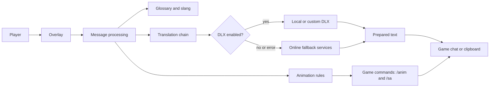

<p align="center">
  
</p>

<h1 align="center">FiveM Chat Overlay</h1>

<p align="center">Translate GTA V roleplay chat as you type, and trigger character animations from message keywords.</p>

[](https://github.com/Ven4esters/FiveM-Chat-Overlay/actions/workflows/ci.yml)
[](https://github.com/Ven4esters/FiveM-Chat-Overlay/releases)
[](LICENSE)
[](https://www.microsoft.com/windows)

[🇷🇺 Читать на русском](README.ru.md)

## Contents

- [About](#about)
- [Features](#features)
- [Screenshots](#screenshots)
- [Quick start](#quick-start)
- [Requirements](#requirements)
- [Usage](#usage)
- [Configuration](#configuration)
- [Architecture](#architecture)
- [Tests and CI](#tests-and-ci)
- [Troubleshooting](#troubleshooting)
- [Security and privacy](#security-and-privacy)
- [Contributing](#contributing)
- [License](#license)
- [Contact](#contact)

## About

FiveM Chat Overlay is a Windows desktop overlay for GTA V and FiveM roleplay
players. It prepares chat messages in another language and can send them to the
game without leaving the current session. Optional keyword rules trigger
character animations. The interface is available in Russian and English.

## Features

- Translate marked text or use the automatic message counter with Google and
  fallback translation services.
- Optionally try a local DLX/DeepL service before online fallback translators.
- Apply language glossaries and expand slang and abbreviations before translation.
- Choose whether the game receives the translated text or a Russian reading.
- Match animation keywords and send `/anim` and `/sa` commands to the game.
- Browse named animation variants with a scrollable, keyboard-accessible chooser.

## Screenshots

The settings screenshot shows the Russian interface. It is a real application
screen, not a mock-up.

The settings window uses a dark navy-and-blue theme and supports Russian and English.

The workflow diagram also has Russian labels: press the hotkey, open the game
chat, type in the overlay, then submit the prepared message. The defaults shown
are **F6** for the overlay and **T** for the game chat; both are configurable
in Settings.


## Quick start

1. Download `FiveMChatOverlay.exe` from the official [GitHub Releases](https://github.com/Ven4esters/FiveM-Chat-Overlay/releases) page.
2. Run the executable. The packaged release does not require a separate Python installation.
3. By default, press **F6** to open the overlay; the game chat opens with **T**. Both keys can be changed in Settings. Other players can see that you are typing; press **Esc** to cancel.
4. Type a message and press **Enter**. Set the target language and translation mode in **Settings**.

### Run from source

On Windows, clone the repository and run `source/start.bat`. It finds or installs
Python 3.12, creates a virtual environment, installs application dependencies,
and starts the app.

```powershell
git clone https://github.com/Ven4esters/FiveM-Chat-Overlay.git
cd FiveM-Chat-Overlay
source\start.bat
```

## Requirements

| Component | Minimum | How to check | Needed for |
|---|---|---|---|
| Windows | Windows 10 or 11 | Run `winver` | Application |
| GTA V or FiveM | Installed and running | Open the game before testing chat input | In-game chat and animations |
| Python | 3.12 for source and development; not needed for the release EXE | `py -3.12 --version` | Source launch and tests |
| Internet | Connection to the selected translation service | Open the service test in Settings | Online translation and DeepL |

## Usage

### Translate a message or a marked fragment

In partial-translation mode, wrap text in plus signs to request translation
regardless of the automatic-message counter:

```text
+Can you help me with this?+
```

### Send a character action

Wrap an action in asterisks. Game commands and recipient names are handled
separately from ordinary text:

```text
*waves and smiles* Ciao!
```

### Trigger an animation

Enable **Animations** and **Send to game** in Settings, then add a rule with a
keyword and an `/anim` command. Matching rules can be configured for exact
words, stems, or lemmas. The module is off by default.

## Configuration

Change options in **Settings**. The application saves configuration and user data
under `data/` beside the program when that folder is writable. Otherwise, it
uses `%LOCALAPPDATA%\FiveMChatOverlay` (or `%APPDATA%\FiveMChatOverlay` when
`LOCALAPPDATA` is unset). Logs are in the `logs/` subfolder of the selected data
root.

| Setting | Default | Purpose |
|---|---|---|
| Target language | Italian (`it`) | Destination language |
| Translation mode | Partial | Translate marked fragments and messages selected by the counter |
| Text sent to game | Russian reading | Choose a pronunciation-friendly reading or the original translated text |
| Interface language | Russian | Russian or English menus |
| Auto-translation | Off; counter defaults to every 4th message | Translate selected messages without marking them |
| Send to game | On | Submit prepared text to the game; turn off to copy it instead |
| Local DLX/DeepL | Off | Try the configured local or custom DLX service first |
| Animation rules | Off | Match keywords and send animation commands |
| Overlay hotkey | F6 (default; configurable) | Open the overlay from the game |
| Game chat key | T (default; configurable) | Open the game chat before showing the overlay |

There are no required environment variables for the desktop app. For the local
DLX service's `HOST`, `PORT`, and `TOKEN` options, see its
[setup guide](source/tools/deeplx-local/README.md).

## Architecture

The app keeps chat processing, translation, game input, and animation matching
in separate components. Translation services are tried in order; optional DLX
runs before the online fallback chain. Animation rules use the original message
and send commands through the game-input adapter. Animation rules, playback,
chooser, and settings editors are grouped in `source/app/animations/`; their
regression tests live in `source/tests/animations/`. Small top-level compatibility
modules preserve established imports while application code uses the package.



## Tests and CI

Run the deterministic unit and integration suite from the repository root:

```powershell
python -m pip install -r source/requirements.txt
python -m pip install pytest pytest-cov ruff bandit pip-audit
ruff check source
ruff format --check source
python -m pytest source/tests -v
bandit -lll -r source/app
pip-audit -r source/requirements.txt
npm ci --prefix source/tools/deeplx-local
npm test --prefix source/tools/deeplx-local
npm audit --prefix source/tools/deeplx-local --audit-level=high
```

CI displays separate quality, Linux, Windows, local-DLX, documentation-link, and
secret-scan jobs. The Windows job requires the Qt runtime, runs Win32 integration
tests, and smoke-builds the EXE. Linux skips Qt tests if the machine lacks
`libGL.so.1`; Windows CI treats a missing Qt runtime as a failure. See the
[test matrix](docs/TESTING.md) and [UI/UX release checklist](docs/UI_UX_REVIEW.md).

Documentation checks:

```powershell
npx --yes markdownlint-cli2@0.24.2 --config .markdownlint-cli2.jsonc README.md README.ru.md CONTRIBUTING.md SECURITY.md '.github/**/*.md' 'docs/**/*.md' 'source/tools/deeplx-local/*.md'
python source/tools/check_readme.py
```

## Troubleshooting

<details>
<summary>DLX is running but DeepL returns 503</summary>

The local process is reachable, but the upstream DeepL request failed. Check the
network and configured proxy, connect a custom DLX endpoint, or disable DLX to
use the regular translator chain. Follow the [DLX troubleshooting guide](docs/DEEPLX-RUSSIA.md).

</details>

<details>
<summary>The game was not found or the message was not sent</summary>

Start GTA V or FiveM before opening the overlay. Check the game-chat key and
**Send to game** settings. The error and resolution log explains where to find
logs and how to diagnose a failed send: [Errors and fixes](docs/ERRORS_AND_FIXES.md).

</details>

<details>
<summary>Where are logs stored?</summary>

The app writes `logs/app.log` and `logs/errors.log` under the writable data root.
If the program folder is not writable, check `%LOCALAPPDATA%\FiveMChatOverlay\logs`.
Review and redact logs before sharing them.

</details>

## Security and privacy

Messages submitted for translation are sent to the selected external service.
DLX runs locally but forwards text to DeepL. Up to 2,000 translation pairs are
also kept in the local, unencrypted `data/cache.json`. Clear it from Settings,
or enable daily, weekly or monthly automatic cleanup. Routine logs record message
metadata, not chat contents; review logs before sharing. Optional performance
reporting is off by default and writes aggregate timings to `data/usage-report.md`;
it never records chat text or sends the report. Download releases only from the
official Releases page. Private vulnerability reporting is currently disabled
in the repository settings. Until maintainers enable the private advisory form,
do not post vulnerability details publicly; see [`SECURITY.md`](SECURITY.md) for
the current reporting instructions.

### Checksum and VirusTotal cross-check

| Check | Reference value | What to verify |
|---|---|---|
| Build version | `1.18.0` | Must match the EXE being checked. |
| MD5 | `a40fb74101f3b963a24cb30bad75811a` | Compare with `dist/FiveMChatOverlay.exe.md5`. Useful for accidental changes, but not reliable proof of authenticity. |
| SHA-256 | `e6be035ad6a515a4d7f54d7fecdd3cecb347ed45c48696f1c2259971450bbecc` | Compare with `dist/FiveMChatOverlay.exe.sha256` and the file hash on VirusTotal; this is the primary identifier for this build. |
| VirusTotal | [SHA-256 lookup page](https://www.virustotal.com/gui/file/e6be035ad6a515a4d7f54d7fecdd3cecb347ed45c48696f1c2259971450bbecc?nocache=1) | The link alone does not confirm a completed scan or a clean verdict. Match the SHA-256 and review the scan date, engine names, and sandbox behavior. |
| Possible heuristic factors | PyInstaller one-file packaging and temporary extraction; a global hotkey and `SendInput`; no Authenticode signature; optional DLX download and launch after user consent. | These are factors to investigate, not a confirmed cause of any specific detection and not proof of a false positive. |

## Contributing

Bug reports and focused pull requests are welcome. Read
[`CONTRIBUTING.md`](CONTRIBUTING.md) and [`STYLEGUIDE.md`](STYLEGUIDE.md) first;
include regression tests and update the relevant documentation when behavior
changes.

For uploading files to an existing GitHub repository or creating a GitHub Release, use the single menu-driven [`tools/github_publish.bat`](tools/github_publish.bat). See [`docs/GITHUB_SCRIPTS_RU.md`](docs/GITHUB_SCRIPTS_RU.md) for setup and usage.

## License

Distributed under the [MIT License](LICENSE).

## Contact

- Author: [Ven4esters](https://github.com/Ven4esters)
- Questions and bug reports: [GitHub Issues](https://github.com/Ven4esters/FiveM-Chat-Overlay/issues)
