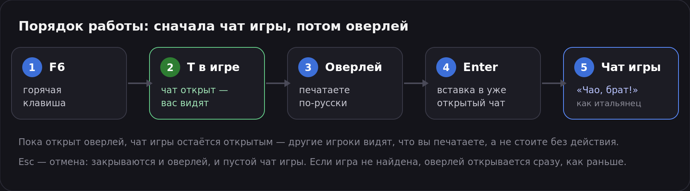
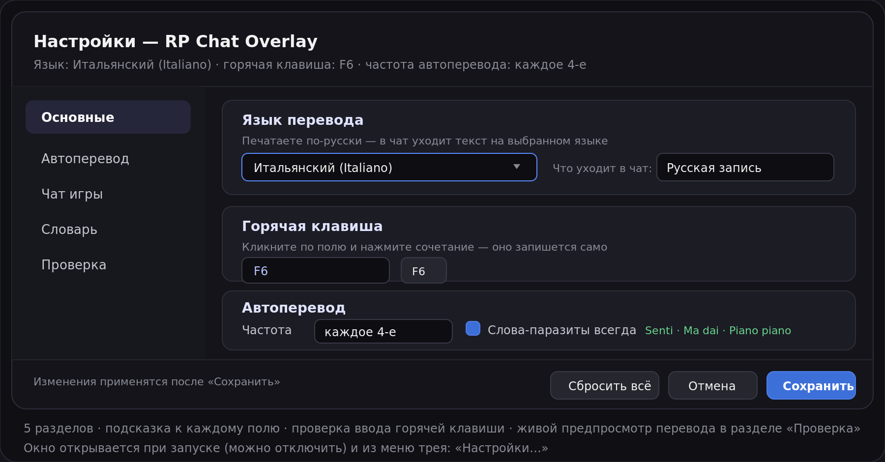
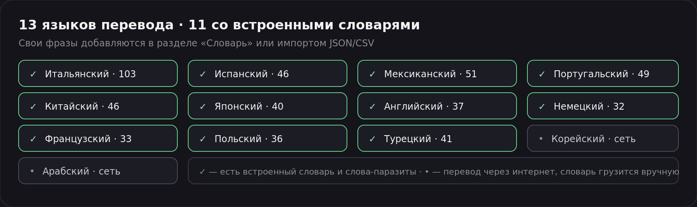

# 🎮 RP Chat Overlay — переводчик чата для GTA V / FiveM


Печатаете по-русски — в чат игры уходит фраза на выбранном языке.
Оверлей сначала открывает чат игры (**T**), чтобы окружающие видели, что вы пишете,
затем показывает окно перевода и отправляет текст.

---

# ✅ ГОТОВЫЙ EXE УЖЕ ЛЕЖИТ В ПАПКЕ `dist`

> ### 📦 `dist/RPChatOverlay.exe` — 37,4 МиБ, запускайте двойным кликом
>
> | | |
> |---|--|
> | **Что сделать** | Скачать папку `dist` и запустить `RPChatOverlay.exe` |
> | **Что устанавливать** | **Ничего** — Python, PySide6 и все библиотеки внутри exe |
> | **Первый запуск** | Рядом появятся `data\` (настройки и словари) и `logs\` (журнал) |
> | **Сборка** | Python 3.12.8 · PySide6 6.8.1 · PyInstaller 6.22 · onefile, без консоли |
> | **MD5** | `112fff632505e16ccf742c46c621414d` |
>
> Папка **`source/`** нужна только для разработки и пересборки — игрокам её передавать не обязательно.
> Подробности про файл: **`dist/ЧИТАЙ_МЕНЯ.txt`** (или `dist/READ_ME.txt` — то же самое латиницей:
> некоторые архиваторы показывают кириллические имена как `╨з╨Ш╨в╨Р╨Щ_╨Ь╨Х╨Э╨п`, это одно и то же).

> ⚠️ **Антивирус / «Не удалось проверить издателя»** — exe не подписан, это обычная реакция
> на PyInstaller: «Подробнее» → «Выполнить в любом случае». Если файл удаляется — добавьте папку в исключения.

---

## 📁 Структура проекта

```
italian-overlay/
├─ dist/                          ← ГОТОВАЯ ПРОГРАММА
│  ├─ RPChatOverlay.exe           ← запускать это (37,4 МиБ)
│  ├─ ЧИТАЙ_МЕНЯ.txt              ← инфо о файле: размер, MD5, сборка
│  └─ READ_ME.txt                 ← тот же текст, имя латиницей (для старых архиваторов)
│
├─ source/                        ← исходники и сборка
│  ├─ main.py                     ← точка входа (--settings, --selftest, --find-game, --langs)
│  ├─ settings_ui.py              ← окно настроек
│  ├─ overlay.py                  ← оверлей: чат игры → окно → отправка
│  ├─ engine.py                   ← маркеры, действия, словарь, автоперевод, паразиты
│  ├─ gamesend.py                 ← окно GTA, фокус, открытие/закрытие чата, ввод
│  ├─ translator.py · translit.py ← перевод ru → язык и русская запись по звучанию
│  ├─ langs.py · langpacks/       ← 13 языков и встроенные словари
│  ├─ glossary_data.py            ← итальянский словарь (103 фразы)
│  ├─ autoplan.py · hotkey.py · common.py
│  ├─ start.bat                   ← запуск из исходников (сам ставит Python и библиотеки)
│  ├─ build_exe.bat               ← сборка exe → ../dist/RPChatOverlay.exe
│  ├─ RPChatOverlay.spec          ← пресет PyInstaller
│  ├─ requirements.txt · icon.ico · icon.png
│  └─ images/                     ← картинки для этого README
│
├─ .github/workflows/build-windows.yml   ← сборка exe в облаке GitHub
├─ .gitignore · .gitattributes
└─ README.md
```

Запуск из исходников: `source\start.bat` (если `dist\RPChatOverlay.exe` уже есть — он просто откроет его).
Сборка exe: `source\build_exe.bat` → результат **всегда** в `dist\`.

---

## 🚀 Быстрый старт

| Шаг | Действие |
|:---:|----------|
| **1** | Запустите `dist\RPChatOverlay.exe` |
| **2** | В окне настроек выберите язык, проверьте горячую клавишу → **Сохранить** |
| **3** | В игре: **F6** → печатаете по-русски → **Enter** → текст улетает в чат |

> 💡 **Esc** — отмена: закрываются и оверлей, и пустой чат игры.
> ⚠️ Если игра запущена от администратора — программу тоже запускайте от администратора.

---

## 🖼 Как это выглядит







---

## ⚙️ Окно настроек

Открывается при запуске (можно отключить) и из меню трея → **«Настройки…»**.
Слева разделы, справа параметры; подсказка есть у каждого поля; изменения применяются по кнопке **«Сохранить»**.

| Раздел | Что настраивается |
|--------|-------------------|
| 🧩 **Основные** | Язык перевода · «что уходит в чат» (русская запись или текст на языке) · горячая клавиша с ловлей нажатия · открывать окно при запуске · скобки перевода · лимит символов · задержка перевода |
| 🔁 **Автоперевод** | включение · частота «каждое N-е» · какое сообщение в серии · число и длина фрагментов · приоритет словаря · **слова-паразиты «всегда»** + их список |
| 🎮 **Чат игры** | вставлять в чат · **сначала открывать чат (T)** · отправлять сразу (Enter) · клавиша чата · три задержки |
| 📚 **Словарь** | таблица «фраза · русская запись · русские значения» с поиском · добавить/удалить · **Импорт JSON/CSV** · **Экспорт** · вернуть встроенный словарь |
| 🔍 **Проверка** | живой предпросмотр: вводите русскую фразу — видно, что уйдёт в игру и как читается |

---

## 🌍 Языки

| Код | Язык | Словарь | Паразиты |
|-----|------|:-------:|:--------:|
| `it` | 🇮🇹 Итальянский (Italiano) | 103 | 10 (из PDF) |
| `es` | 🇪🇸 Испанский (Español) | 46 | 7 |
| `es-MX` | 🇲🇽 Мексиканский | 51 | 8 |
| `pt-BR` | 🇧🇷 Португальский (Brasil) | 49 | 8 |
| `zh-CN` | 🇨🇳 Китайский (中文) | 46 | 8 |
| `ja` | 🇯🇵 Японский (日本語) | 40 | 8 |
| `en` | 🇬🇧 Английский (English) | 37 | 8 |
| `de` | 🇩🇪 Немецкий (Deutsch) | 32 | 8 |
| `fr` | 🇫🇷 Французский (Français) | 33 | 9 |
| `pl` | 🇵🇱 Польский (Polski) | 36 | 8 |
| `tr` | 🇹🇷 Турецкий (Türkçe) | 41 | 9 |
| `ko` | 🇰🇷 Корейский (한국어) | сеть | — |
| `ar` | 🇸🇦 Арабский (العربية) | сеть | — |

<details>
<summary><b>Почему именно эти языки</b></summary>

На RP-серверах GTA V за пределами русскоязычного сегмента чаще всего встречаются
английский, бразильский португальский, немецкий, французский, испанский (в том числе
мексиканский), польский, турецкий, арабский; отдельные крупные сообщества — итальянские,
японские, корейские.
</details>

---

## 📚 Свои словари

Раздел **«Словарь» → «Импорт…»**, два формата.

**CSV** (`;`, заголовок можно не писать):

```csv
Фраза;Русская запись;Русские значения
Andiamo;анджамо;пошли; идём; поехали
Che bello;ке белло;как красиво; класс; супер
```

**JSON**:

```json
{"_version": 1, "phrases": {"Andiamo": "анджамо | пошли; идём; поехали"}}
```

> Импорт **дополняет**: новые фразы добавляются, у существующих дописываются значения,
> ваши транскрипции не меняются. Файлы словарей: `data/glossaries/<код>.json` рядом с exe.
> Фразы со звёздочкой **★** — слова-паразиты, переводятся в каждом сообщении.

---

## 🧠 Как это работает

| Приём | Пример | Результат |
|-------|--------|-----------|
| Обычный текст | `привет` | `Чао` (или `Ciao` в режиме «текст на языке») |
| Принудительно | `+привет+` | `Чао` — даже если автоперевод выключен |
| Действие | `*почесал затылок*` | остаётся как есть |
| Автоперевод | `мне срочно нужна Aiutami` | одно сообщение из N |
| Слова-паразиты | `Слушай, брат` | `Сенти, брат` — **в каждом** сообщении |
| Команда с ником | `/to Ivan слушай` | `/to Ivan Сенти` — ник не переводится |

<details>
<summary><b>Счётчик сообщений и команды</b></summary>

`/to`, `/lto`, `/l`, `/wt`, `/s`, `/st` считаются наравне с обычными сообщениями:
двигают серию автоперевода и сами могут переводиться.
`/me`, `/do`, `/b` в счётчик не идут, но `+маркеры+` в них работают.
</details>

<details>
<summary><b>Слова-паразиты по языкам</b></summary>

| Язык | Примеры |
|------|---------|
| Итальянский | Senti · Ma dai · Madonn' · Mannaggia · Capisci? · Che vuoi fare? · Scemo · Agita · Allora · Piano piano |
| Испанский | Oye · ¿Entiendes? · Pues · Joder · Venga · Qué le vamos a hacer · Poco a poco |
| Мексиканский | Órale · No manches · Güey · ¿Mande? · Ni modo |
| Португальский | Ouve · Entendeu? · Então · Tipo · Pô · Nossa · Fazer o quê |
| Китайский | 那个 · 就是 · 你听我说 · 你懂吗 · 没办法 · 慢慢来 |
| Японский | あの · なんか · 聞いて · わかる? · しょうがない · ゆっくり |
| Английский, немецкий, французский, польский, турецкий | по 8–9 фраз |
</details>

---

## 🛠 Пересборка exe

```bat
source\build_exe.bat
:: результат: dist\RPChatOverlay.exe
```

Что делает скрипт: находит Python 3.12 → создаёт окружение `source\.build-venv` →
ставит `deep-translator`, `PySide6`, `PyInstaller` → собирает один exe по
`source\RPChatOverlay.spec` → кладёт результат в `dist\`.

<details>
<summary><b>Что учтено в сборке</b></summary>

- `console=False` — окно консоли не появляется, журнал пишется в `logs\app.log`;
- иконка `icon.ico` в exe и в трее;
- `langpacks/*` импортируются статически (иначе PyInstaller не включает модули и exe падает
  с «No module named langpacks.it»);
- `deep_translator` и его зависимости включены;
- лишние модули Qt (QML, WebEngine, Multimedia, Charts, 3D, OpenGL) исключены — поэтому exe «всего» 37 МиБ;
- `data\` и `logs\` создаются рядом с exe; если там нет прав записи (например, `Program Files`) —
  данные уходят в `%LOCALAPPDATA%\RPChatOverlay`.
</details>

---

## ❓ FAQ

<details>
<summary><b>Не удалось проверить издателя / антивирус ругается</b></summary>

Exe не подписан — «Подробнее» → «Выполнить в любом случае», папку добавьте в исключения антивируса.
</details>

<details>
<summary><b>Китайский / японский в чате виден как «???»</b></summary>

Сервер или шрифт игры не поддерживает CJK. Переключите «Что уходит в чат» на **русскую запись** —
в чат уйдёт «Нихао» вместо 你好.
</details>

<details>
<summary><b>Сообщения не появляются в чате</b></summary>

Увеличьте «После открытия чата» до 500–800 мс в разделе **Чат игры**; проверьте, что игра и оверлей
запущены с одинаковыми правами.
</details>

<details>
<summary><b>Перевод без интернета</b></summary>

Фразы из словаря и слова-паразиты работают офлайн. Для остального текста нужен Google/MyMemory,
иначе появится «Ошибка перевода» и текст можно отправить как есть (Enter).
</details>

<details>
<summary><b>Где настройки, словари и логи</b></summary>

`data\config.json` · `data\glossaries\<код>.json` · `data\cache.json` · `logs\app.log`
(рядом с `RPChatOverlay.exe`).
</details>

---

## 🧪 Диагностика из консоли

```bat
cd source
python main.py --selftest      :: проверка перевода по нескольким языкам (офлайн)
python main.py --langs         :: список языков и наличие словарей
python main.py --find-game     :: список окон и найденная игра
python main.py --settings      :: сразу открыть настройки
```

---

<p align="center"><sub>RP Chat Overlay · Windows 10/11 · Python 3.12 · PySide6 · перевод: Google gtx → deep-translator → MyMemory</sub></p>
