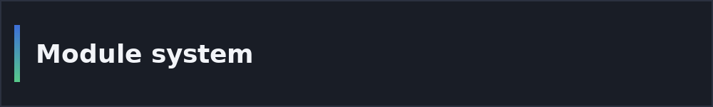
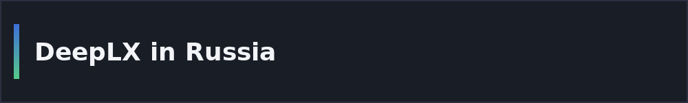
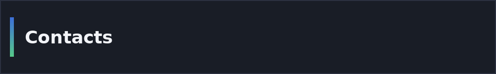

# 🎮 Chat&AutoAnimations RP Overhaul

[🇷🇺 Читать на русском](README.ru.md)

[](https://github.com/Ven4esters/RP-Chat-Overlay/releases)
[](https://www.python.org/downloads/release/python-312/)


[](https://www.virustotal.com/gui/file/9a6c8da2e9472ee89ee3a6f6311844ed0a983d00327857a1749dc5782cc34749?nocache=1)


> Chat overlay with DeepL/Google translation and automatic animation application for roleplay games (GTA 5).

<a id="contents"></a>


- [About the project](#about-the-project)
- [Features](#features)
- [Tech stack](#tech-stack)
- [Requirements](#requirements)
- [Installation](#installation)
- [VirusTotal report and 2/70 detections](#virustotal-report)
- [Module system](#module-system)
- [Translation modes and special symbols](#translation-modes-and-special-symbols)
- [DeepLX in Russia](#deeplx-in-russia)
- [License](#license)
- [Contacts](#contacts)

<a id="about-the-project"></a>


The project is an overlay for roleplay chat in GTA 5. It translates incoming
and outgoing messages through DeepL (local service) or Google Translate, and
automatically applies character animations based on keyword matching.
The interface language can be switched between Russian and English without
restarting.

<a id="features"></a>


- Translate chat messages through DeepL or Google Translate
- Automatic animation triggers based on keyword matching
- Built-in glossaries and slang expansion for several languages
- DLX local service management (install, start, stop, proxy)
- Russian and English interface

<a id="tech-stack"></a>


Python 3.12 · PySide6 · deep-translator

<a id="requirements"></a>


- Windows 10 / 11
- GTA 5
- Python ≥ 3.12 (to run from sources)
- Internet connection for translation services

<a id="installation"></a>


### Compiled release (recommended)

Download the latest build from [GitHub Releases](https://github.com/Ven4esters/RP-Chat-Overlay/releases):

| File | SHA-256 | MD5 | Size |
|---|---|---|---|
| `RPChatOverlay.exe` | `9a6c8da2e9472ee89ee3a6f6311844ed0a983d00327857a1749dc5782cc34749` | `d854ac6a2c7d860ec59a5dd7acbc1a9e` | 47.7 MiB (49 990 457 bytes) |

Verify the checksum after downloading, then run `RPChatOverlay.exe`.

### From sources

```bash
git clone https://github.com/Ven4esters/RP-Chat-Overlay.git
cd RP-Chat-Overlay
```

Run `source/start.bat` — it finds or installs Python 3.12, creates a virtual
environment, installs dependencies and launches the app.

<a id="virustotal-report"></a>


The linked [VirusTotal report](https://www.virustotal.com/gui/file/9a6c8da2e9472ee89ee3a6f6311844ed0a983d00327857a1749dc5782cc34749?nocache=1)
for this release hash shows **2 of 70** antivirus engines flagging the executable.
The ratio alone does not prove either that the file is malicious or that the
detections are false positives; engines use different signatures and heuristics,
and results can change over time.

A plausible source of generic or heuristic detections is the way the app is
distributed: it is a self-contained Windows executable built with PyInstaller,
bundling the Python runtime and dependencies. Packed applications that unpack
components when launched, and builds with little reputation, can attract
heuristic alerts. These are possible contributing factors—not verified
explanations for the exact two detections. Check the engine names and detection
labels in the linked report for the current details.

Download the executable only from the official [GitHub Releases](https://github.com/Ven4esters/RP-Chat-Overlay/releases)
page and verify its SHA-256 against the value above. If the checksum differs,
do not run the file. If your antivirus blocks it, review the vendor's exact
detection name and submit the file to that vendor for analysis rather than
disabling protection globally.

<a id="module-system"></a>


The program is built from independent modules. Any module can be disabled in
settings — a disabled module does not break the rest, the program keeps
working in a reduced mode. If a module that another depends on is disabled,
the dependent is also reported as disabled.

### Modules (in settings window order)

| Setting | What it does | Default |
|---|---|---|
| **Online translation** | The chain of Google, MyMemory, Lingva and LibreTranslate translates messages through the internet. Without it only the built-in glossaries work. | On |
| **Glossary** | Ready-made phrases with a Russian reading and meanings. Lets you see "how to read aloud" instead of raw service translation. | On |
| **Slang and abbreviations** | Expands `brb`, `afk`, `gg` and their Russian counterparts into full phrases before translation, so machine translation doesn't mangle the shortcut. | On |
| **Auto-translation** | Every N-th message is translated automatically without pressing a button. Requires online translation. Works only in partial translation mode. | Off |
| **Sending into the game** | The overlay opens the game chat, pastes the translated text and presses Enter. When off, the text is only copied to the clipboard. | On |
| **DeepL alongside (DLX)** | A local DeepL service on your computer used as the first translator. Needs consent and about 15 MB on disk. | Off |
| **Animations** | A keyword in your message starts `/anim` in the game, and `/sa` follows after the configured delay. Requires sending into the game. | Off |
| **Global hotkey** | Opens the overlay from inside the game with one key. Without it — double-click the tray icon. | On |

### Configuration variables

Settings are stored in `data/config.json` next to the executable. Do not put
real keys into the repository — they belong in the local data folder only.

#### Language and direction of translation

| Setting | Description | Default value |
|---|---|---|
| Target language | Which language to translate messages into (Italian, Spanish, English, etc.) | Italian (`it`) |
| Sending mode | Which text to send to chat: Russian reading ("how to read aloud") or the original foreign text | Russian reading |
| Translation mode | What text to translate: the whole message, only part, or any language → Russian | Partial |

#### Program interface

| Setting | Description | Default value |
|---|---|---|
| Interface language | Russian or English for menus and tooltips | Russian (`ru`) |
| Interface scale | Size of overlay elements relative to the screen | 100 % |
| Always on top | The overlay is displayed above the game and is not hidden behind it | Enabled |

#### Modules

| Setting | Description | Default value |
|---|---|---|
| Online translation | Online translation via Google, MyMemory, Lingva, LibreTranslate | On |
| Glossary | Built-in ready-made phrases with Russian reading | On |
| Global hotkey | Open the overlay with one key from inside the game | On |
| DeepL alongside (DLX) | A local DeepL service on your computer | Off |
| Slang and abbreviations | Expand `brb`, `afk`, `спс` and others before translation | On |

#### Text and special markers

| Setting | Description | Default value |
|---|---|---|
| Forced fragment marker | Symbol to mark text that must be translated forced (`+...+`) | `+` |
| Maximum message length | Character limit for one message to translate | 256 |
| Pause before translation | Delay after typing before automatic translation starts | 450 ms |
| Parasite words always | Add filler words (`Senti`, `Ma dai` etc.) to every message | Enabled |

#### Auto-translation

| Setting | Description | Default value |
|---|---|---|
| Auto-translate on | Translate every N-th message automatically | Off |
| Every N-th message | Frequency of automatic translation (which message number) | 4th |
| Fragment position | Which part of the message to translate: end, beginning, random | End |
| Dictionary priority | Check built-in dictionary before online translation | Enabled |

#### Sending into the game

| Setting | Description | Default value |
|---|---|---|
| Send into the game | Pass text to the game chat window | On |
| Press Enter | Press Enter automatically after pasting text | Off |
| Chat key | Key to open chat in the game (e.g. `T`) | `T` |
| Input method | How to insert text: via clipboard (Ctrl+V) or character by character | Clipboard |

#### Animations

| Setting | Description | Default value |
|---|---|---|
| Animations module | Enable animation launch by keywords | Off |
| Animation rules | Which words trigger which animation (`/anim name`) | Empty |
| Stop key | Key to stop animation playback | `F` |
| Stop with `/sa` command | Stop animation with `/sa` command in game | Enabled |
| "In a vehicle" mode | Don't play animations and don't send `/sa` while enabled | Off |

<a id="translation-modes-and-special-symbols"></a>


The program supports several translation methods and special markers in text:

### Auto-translate

Every N-th message is translated automatically. For commands `/to`, `/lto`,
`/l`, `/wt`, `/s`, `/st` auto-translate applies the same as to regular
messages.

### Forced fragment translation `+...+`

Wrap part of the text in `+` — the fragment will be translated even when
auto-translate is disabled. Example: `+`привет, брат`+` — always goes to chat
in the target language.

### Actions `*...*`

Text in asterisks is perceived as character action and translated in full.
Service commands (`/me`, `/do`, `/to`) and nicknames are not translated.

### Parasite words

These are filler words inserted into **every** message regardless of the
auto-translate counter: `Senti`, `Ma dai`, `Oye`, `那个` and others. Enabled
with a checkbox next to the phrase in the dictionary.

### Dictionary priority over translation

If a phrase exists in the built-in or user dictionary, it is translated
according to the dictionary entry (with the Russian transcription "how to
read aloud") and does not go to external translation services. The dictionary
takes priority over network translation.

<a id="deeplx-in-russia"></a>


Since June 2025, DeepL is blocked for Russian IP addresses. The local DLX
service starts, but DeepL returns error `503` — state
**«Работает, но DeepL не отвечает (503)»**.

Workaround: use an **HTTP proxy** (v2rayN, Clash, SOCKS5) or deploy your own
DLX server abroad ([detailed instructions](docs/DEEPLX-RUSSIA.md)).
If there is no proxy, simply disable DLX — the program falls back to regular
translation services without restrictions.

<a id="license"></a>


[MIT](LICENSE)

<a id="contacts"></a>


- Author: [Ven4esters](https://github.com/Ven4esters)
- Issues and suggestions: [GitHub Issues](https://github.com/Ven4esters/RP-Chat-Overlay/issues)