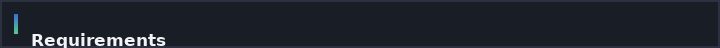

# 🎮 Chat&AutoAnimations RP Overhaul

[](https://github.com/Ven4esters/RP-Chat-Overlay/releases)
[](https://www.python.org/downloads/release/python-312/)


[](https://www.virustotal.com/gui/file/9a6c8da2e9472ee89ee3a6f6311844ed0a983d00327857a1749dc5782cc34749?nocache=1)


> Chat overlay with DeepL/Google translation and automatic animation application for roleplay games (GTA 5).

## Содержание
- [About the project](#about-the-project)
- [Features](#features)
- [Tech stack](#tech-stack)
- [Requirements](#requirements)
- [Installation](#installation)
- [Quick start](#quick-start)
- [Configuration](#configuration)
- [Translation modes and special symbols](#translation-modes-and-special-symbols)
- [DeepLX in Russia](#deeplx-in-russia)
- [License](#license)
- [Contacts](#contacts)

## About the project


The project is an overlay for roleplay chat in GTA 5. It translates incoming
and outgoing messages through DeepL (local service) or Google Translate, and
automatically applies character animations based on keyword matching.
The interface language can be switched between Russian and English without
restarting.

## Features


- Translate chat messages through DeepL or Google Translate
- Automatic animation triggers based on keyword matching
- Built-in glossaries and slang expansion for several languages
- DLX local service management (install, start, stop, proxy)
- Russian and English interface

## Tech stack


Python 3.12 · PySide6 · deep-translator

## Requirements



- Windows 10 / 11
- GTA 5
- Python ≥ 3.12 (to run from sources)
- Internet connection for translation services

## Installation


### Compiled release (recommended)

Download the latest build from [GitHub Releases](https://github.com/Ven4esters/RP-Chat-Overlay/releases):

| File | SHA-256 | MD5 | Size |
|---|---|---|---|
| `RPChatOverlay.exe` | `9a6c8da2e9472ee89ee3a6f6311844ed0a983d00327857a1749dc5782cc34749` | `d854ac6a2c7d860ec59a5dd7acbc1a9e` | 47.7 MiB (49 990 457 bytes) |

Verify the checksum after downloading, then run `RPChatOverlay.exe`.

### From sources

```bash
git clone https://github.com/Ven4esters/RP-Chat-Overlay.git
cd RP-Chat-Overlay
```

Run `source/start.bat` — it finds or installs Python 3.12, creates a virtual
environment, installs dependencies and launches the app.

## Quick start


```bash
source/start.bat
```

The overlay appears as a tray icon. Press the configured hotkey to show the
chat window. Incoming/outgoing messages are translated automatically;
animations start on keyword match.

Open **Settings → DeepL** to configure the local translation service, or
**Settings → Animations** to manage animation rules.

## Configuration


| Variable | Required | Default | Description |
|---|---|---|---|
| `ui_lang` | no | `ru` | Interface language (`ru` / `en`) |
| `target_lang` | no | `it` | Translation target language |
| `dlx_url` | no | — | Address of your own DeepL service |
| `dlx_url_token` | no | — | Bearer token for your own DeepL service |

Settings are stored in `data/config.json` next to the executable. Do not put
real keys into the repository — they belong in the local data folder only.

## Translation modes and special symbols


The program supports several translation methods and special markers in text:

### Auto-translate

Every N-th message is translated automatically. For commands `/to`, `/lto`,
`/l`, `/wt`, `/s`, `/st` auto-translate applies the same as to regular
messages.

### Forced fragment translation `+...+`

Wrap part of the text in `+` — the fragment will be translated even when
auto-translate is disabled. Example: `+`привет, брат`+` — always goes to chat
in the target language.

### Actions `*...*`

Text in asterisks is perceived as character action and translated in full.
Service commands (`/me`, `/do`, `/to`) and nicknames are not translated.

### Parasite words

These are filler words inserted into **every** message regardless of the
auto-translate counter: `Senti`, `Ma dai`, `Oye`, `那个` and others. Enabled
with a checkbox next to the phrase in the dictionary.

### Dictionary priority over translation

If a phrase exists in the built-in or user dictionary, it is translated
according to the dictionary entry (with the Russian transcription "how to
read aloud") and does not go to external translation services. The dictionary
takes priority over network translation.

## DeepLX in Russia


Since June 2025, DeepL is blocked for Russian IP addresses. The local DLX
service starts, but DeepL returns error `503` — state
**«Работает, но DeepL не отвечает (503)»**.

Workaround: use an **HTTP proxy** (v2rayN, Clash, SOCKS5) or deploy your own
DLX server abroad ([detailed instructions](docs/DEEPLX-RUSSIA.md)).
If there is no proxy, simply disable DLX — the program falls back to regular
translation services without restrictions.

## License


[MIT](LICENSE)

## Contacts


- Author: [Ven4esters](https://github.com/Ven4esters)
- Issues and suggestions: [GitHub Issues](https://github.com/Ven4esters/RP-Chat-Overlay/issues)