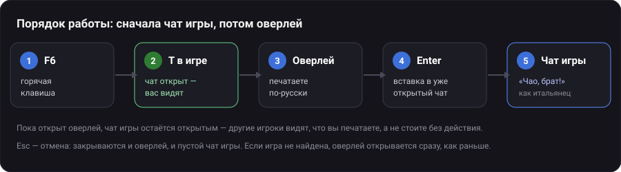
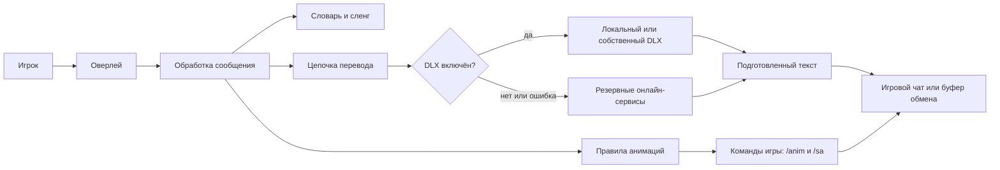

<p align="center">
  
</p>

<h1 align="center">RP Chat Overlay</h1>

<p align="center">Переводите ролевой чат в GTA V прямо во время набора и запускайте анимации персонажа по ключевым словам.</p>

[](https://github.com/Ven4esters/RP-Chat-Overlay/actions/workflows/ci.yml)
[](https://github.com/Ven4esters/RP-Chat-Overlay/releases)
[](LICENSE)
[](https://www.microsoft.com/windows)

[🇬🇧 Read in English](README.md)

## Содержание

- [О проекте](#о-проекте)
- [Возможности](#возможности)
- [Скриншоты](#скриншоты)
- [Быстрый старт](#быстрый-старт)
- [Требования](#требования)
- [Использование](#использование)
- [Настройки](#настройки)
- [Архитектура](#архитектура)
- [Тесты и CI](#тесты-и-ci)
- [Устранение неполадок](#устранение-неполадок)
- [Безопасность и приватность](#безопасность-и-приватность)
- [Участие в разработке](#участие-в-разработке)
- [Лицензия](#лицензия)
- [Контакты](#контакты)

## О проекте

RP Chat Overlay — настольный оверлей для ролевого чата в GTA V и FiveM под
Windows. Он подготавливает сообщения на другом языке и при желании отправляет
их в игру. Дополнительные правила запускают анимации персонажа по ключевым
словам. Интерфейс доступен на русском и английском языках.

## Возможности

- Переводить отмеченные фрагменты или сообщения, выбранные счётчиком автоперевода.
- При желании сначала обращаться к локальному или собственному DLX/DeepL-сервису,
  а при сбое использовать онлайн-переводчики.
- Подставлять фразы из словаря и раскрывать сленг и сокращения до перевода.
- Выбирать, что отправить в игру: перевод или русскую запись произношения.
- Находить правила анимаций и отправлять в игру команды `/anim` и `/sa`.
- Выбирать варианты анимации в прокручиваемом меню с поддержкой клавиатуры.

## Скриншоты

На скриншоте настроек показан настоящий экран приложения с русским интерфейсом,
а не макет.


*Окно настроек, русский интерфейс.*

На схеме показан порядок действий: горячая клавиша, открытие игрового чата,
ввод в оверлее и отправка подготовленного сообщения.



## Быстрый старт

1. Скачайте `RPChatOverlay.exe` с официальной страницы [GitHub Releases](https://github.com/Ven4esters/RP-Chat-Overlay/releases).
2. Запустите файл. Для готовой сборки отдельно устанавливать Python не нужно.
3. В GTA V или FiveM нажмите **F6**, чтобы открыть оверлей и игровой чат. Другие игроки видят, что вы печатаете; **Esc** отменяет ввод.
4. Введите сообщение и нажмите **Enter**. Целевой язык и режим перевода задаются в **Настройках**.

### Запуск из исходников

В Windows склонируйте репозиторий и запустите `source/start.bat`. Скрипт найдёт
или установит Python 3.12, создаст виртуальное окружение, установит зависимости
приложения и запустит его.

```powershell
git clone https://github.com/Ven4esters/RP-Chat-Overlay.git
cd RP-Chat-Overlay
source\start.bat
```

## Требования

| Компонент | Минимум | Как проверить | Для чего нужен |
|---|---|---|---|
| Windows | Windows 10 или 11 | Запустите `winver` | Работа приложения |
| GTA V или FiveM | Игра установлена и запущена | Откройте игру перед проверкой отправки в чат | Игровой чат и анимации |
| Python | 3.12 для исходников и разработки; готовой сборке EXE не нужен | `py -3.12 --version` | Запуск исходников и тесты |
| Интернет | Доступ к выбранному сервису перевода | Запустите проверку сервиса в настройках | Онлайн-перевод и DeepL |

## Использование

### Перевести сообщение или отмеченный фрагмент

В частичном режиме заключите текст в знаки «плюс», чтобы запросить перевод
независимо от счётчика автоперевода:

```text
+Поможешь мне с этим?+
```

### Отправить действие персонажа

Заключите действие в звёздочки. Игровые команды и имена получателей
обрабатываются отдельно от обычного текста:

```text
*машет рукой и улыбается* Ciao!
```

### Запустить анимацию

Включите в настройках модули **Анимации** и **Отправка в игру**, затем добавьте
правило с ключевым словом и командой `/anim`. Для совпадений можно выбрать точные
формы, основы или леммы. По умолчанию модуль выключен.

## Настройки

Изменяйте параметры в окне **Настройки**. Если папка приложения доступна для
записи, данные сохраняются рядом с программой в `data/`. Иначе используется
`%LOCALAPPDATA%\RPChatOverlay` (или `%APPDATA%\RPChatOverlay`, если
`LOCALAPPDATA` не задан). Журналы находятся в подпапке `logs` выбранной папки
данных.

| Настройка | По умолчанию | Назначение |
|---|---|---|
| Целевой язык | Итальянский (`it`) | Язык перевода |
| Режим перевода | Частичный | Перевод отмеченных фрагментов и сообщений по счётчику |
| Текст в игровом чате | Русская запись | Отправлять произношение или оригинальный перевод |
| Язык интерфейса | Русский | Русское или английское меню |
| Автоперевод | Выключен; счётчик — каждое 4-е сообщение | Переводить выбранные сообщения без маркеров |
| Отправка в игру | Включена | Отправлять подготовленный текст; при отключении — копировать его |
| Локальный DLX/DeepL | Выключен | Сначала попробовать локальный или собственный DLX-сервис |
| Правила анимаций | Выключены | Искать ключевые слова и отправлять команды анимаций |
| Горячая клавиша оверлея | F6 | Открывать оверлей из игры |

Для настольного приложения переменные окружения не обязательны. Параметры
`HOST`, `PORT` и `TOKEN` локального DLX описаны в его
[инструкции по запуску](source/tools/deeplx-local/README.md).

## Архитектура

Обработка сообщения, перевод, ввод в игру и поиск анимаций разделены на
компоненты. Переводчики запускаются по очереди; включённый DLX используется
перед резервной цепочкой онлайн-сервисов. Правила анимаций проверяются по
исходному сообщению, а команды отправляет адаптер игрового ввода.



## Тесты и CI

Запустите детерминированные unit- и интеграционные тесты из корня репозитория:

```powershell
python -m pip install -r source/requirements.txt
python -m pip install pytest pytest-cov ruff bandit pip-audit
ruff check source
ruff format --check source
python -m pytest source/tests -v
bandit -lll -r source/app
pip-audit -r source/requirements.txt
npm ci --prefix source/tools/deeplx-local
npm test --prefix source/tools/deeplx-local
npm audit --prefix source/tools/deeplx-local --audit-level=high
```

В CI есть отдельные задания качества, Linux-, Windows- и DLX-тестов, проверки
ссылок в документации и сканирования секретов. На Windows обязательны Qt-тесты,
проверки Win32 и пробная сборка EXE. На Linux UI-тесты пропускаются, если
отсутствует `libGL.so.1`; Windows CI считает отсутствие Qt ошибкой. См. [матрицу тестов](docs/TESTING.md) и
[чек-лист UI/UX перед выпуском](docs/UI_UX_REVIEW.md).

Проверка документации:

```powershell
npx --yes markdownlint-cli2@0.24.2 --config .markdownlint-cli2.jsonc README.md README.ru.md CONTRIBUTING.md SECURITY.md '.github/**/*.md' 'docs/**/*.md' 'source/tools/deeplx-local/*.md'
python source/tools/check_readme.py
```

## Устранение неполадок

<details>
<summary>DLX запущен, но DeepL отвечает 503</summary>

Локальный процесс доступен, но запрос к DeepL завершился ошибкой. Проверьте
сеть и прокси, подключите собственный адрес DLX или отключите его, чтобы
вернуться к обычной цепочке переводчиков. См. [инструкцию по DLX](docs/DEEPLX-RUSSIA.md).

</details>

<details>
<summary>Игра не найдена или сообщение не отправилось</summary>

Сначала запустите GTA V или FiveM. Проверьте клавишу игрового чата и настройку
**Отправка в игру**. В [журнале ошибок и решений](docs/ERRORS_AND_FIXES.md)
описано, где искать журналы и как диагностировать сбой отправки.

</details>

<details>
<summary>Где находятся журналы?</summary>

Приложение пишет в `logs/app.log` и `logs/errors.log` внутри доступной для записи
папки данных. Если папка программы недоступна, проверьте
`%LOCALAPPDATA%\RPChatOverlay\logs`. Перед отправкой удалите из журнала ненужные
личные данные.

</details>

## Безопасность и приватность

Текст, отправленный на перевод, передаётся выбранному внешнему сервису. DLX
работает локально, но пересылает текст в DeepL. Обычные журналы содержат
метаданные, а не текст чата; перед отправкой журнала всё равно проверьте его.
Скачивайте сборки только с официальной страницы Releases. Приватная отправка
уязвимостей сейчас отключена в настройках репозитория. Пока сопровождающие не
включат форму приватных рекомендаций, не публикуйте подробности уязвимостей;
текущий порядок описан в [`SECURITY.md`](SECURITY.md).

## Участие в разработке

Сообщения об ошибках и небольшие pull request приветствуются. Перед началом
прочитайте [`CONTRIBUTING.md`](CONTRIBUTING.md) и [`STYLEGUIDE.md`](STYLEGUIDE.md);
добавляйте регрессионные тесты и обновляйте документацию при изменении поведения.

## Лицензия

Проект распространяется по лицензии [MIT](LICENSE).

## Контакты

- Автор: [Ven4esters](https://github.com/Ven4esters)
- Вопросы и сообщения об ошибках: [GitHub Issues](https://github.com/Ven4esters/RP-Chat-Overlay/issues)
