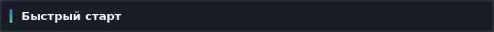
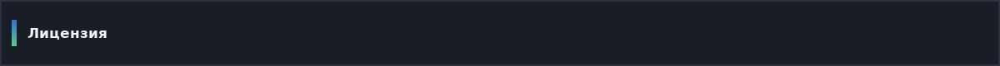

# 🎮 Chat&AutoAnimations RP Overhaul

[](https://github.com/Ven4esters/RP-Chat-Overlay/releases)
[](https://www.python.org/downloads/release/python-312/)


[](https://www.virustotal.com/gui/file/9a6c8da2e9472ee89ee3a6f6311844ed0a983d00327857a1749dc5782cc34749?nocache=1)


> Оверлей чата с переводом через DeepL/Google и автоматизация применения анимаций для ролевой игры (GTA 5).

<a id="о-проекте"></a>


## Содержание

- [О проекте](#о-проекте)
- [Возможности](#возможности)
- [Стек технологий](#стек-технологий)
- [Требования](#требования)
- [Установка](#установка)
- [Быстрый старт](#быстрый-старт)
- [Конфигурация](#конфигурация)
- [Режимы перевода и спецсимволы](#режимы-перевода-испецсимволы)
- [DeepLX в России](#deeplxвроссии)
- [Лицензия](#лицензия)
- [Контакты](#контакты)

<a id="о-проекте"></a>


Проект — оверлей для ролевого чата в GTA 5. Переводит входящие и исходящие
сообщения через DeepL (локальный сервис) или Google Translate, а также
автоматически применяет анимации персонажа по совпадению ключевых слов.
Язык интерфейса можно переключать между русским и английским без перезапуска.

<a id="возможности"></a>


- Перевод сообщений чата через DeepL или Google Translate
- Автоматический запуск анимаций по совпадению ключевых слов
- Встроенные глоссарии и раскрытие сленга на нескольких языках
- Управление локальным сервисом DLX (установка, запуск, остановка, прокси)
- Интерфейс на русском и английском языках

<a id="стек-технологий"></a>


Python 3.12 · PySide6 · deep-translator

<a id="требования"></a>


- Windows 10 / 11
- GTA 5
- Python ≥ 3.12 (для запуска из исходников)
- Подключение к интернету для сервисов перевода

<a id="установка"></a>


### Скомпилированный релиз (рекомендуется)

Скачайте последнюю сборку в [GitHub Releases](https://github.com/Ven4esters/RP-Chat-Overlay/releases):

| Файл | SHA-256 | MD5 | Размер |
|---|---|---|---|
| `RPChatOverlay.exe` | `9a6c8da2e9472ee89ee3a6f6311844ed0a983d00327857a1749dc5782cc34749` | `d854ac6a2c7d860ec59a5dd7acbc1a9e` | 47,7 MiB (49 990 457 байт) |

После скачивания проверьте контрольную сумму, затем запустите `RPChatOverlay.exe`.

### Из исходников

```bash
git clone https://github.com/Ven4esters/RP-Chat-Overlay.git
cd RP-Chat-Overlay
```

Запустите `source/start.bat` — он найдёт или установит Python 3.12, создаст
виртуальное окружение, установит зависимости и запустит приложение.

<a id="быстрый-старт"></a>


Оверлей появляется как значок в трее. Нажмите настроенную горячую клавишу,
чтобы открыть окно чата. Напишите по-русски — в чат игры уйдёт перевод на
выбранном языке. Напишите на иностранном — в чат уйдёт русский перевод.
Входящие и исходящие сообщения переводятся автоматически; анимации
запускаются по совпадению ключевых слов.

Откройте **Настройки → DeepL** для настройки локального сервиса перевода,
или **Настройки → Анимации** для управления правилами анимаций.

<a id="конфигурация"></a>


Программа собрана из независимых модулей. Любой модуль можно выключить в
настройках — выключенный модуль не ломает остальное, программа продолжает
работать в урезанном виде. У каждого модуля есть свой блок настроек с
галочками, полями и кнопками, которые можно менять в любое время.

| Переменная | Обязательна | По умолчанию | Описание |
|---|---|---|---|
| `ui_lang` | нет | `ru` | Язык интерфейса (`ru` / `en`) |
| `target_lang` | нет | `it` | Целевой язык перевода |
| `dlx_url` | нет | — | Адрес вашего сервиса DeepL |
| `dlx_url_token` | нет | — | Bearer-токен для вашего сервиса DeepL |

Настройки сохраняются в `data/config.json` рядом с исполняемым файлом. Не
добавляйте реальные ключи в репозиторий — они принадлежат только локальной
папке с данными.

<a id="режимы-перевода-испецсимволы"></a>


Программа поддерживает несколько способов перевода и особые маркеры в тексте:

### Автоперевод

Каждое N-е сообщение переводится автоматически. Для команд `/to`, `/lto`, `/l`,
`/wt`, `/s`, `/st` автоперевод применяется как к обычным сообщениям.

### Форсированный перевод фрагмента `+...+`

Обёрните часть текста в `+` — фрагмент переведётся даже когда автоперевод
выключен. Например: `+`привет, брат`+` — всегда уйдёт в чат на целевом языке.

### Действия `*...*`

Текст в звёздочках воспринимается как действие персонажа и переводится целиком.
Служебные команды (`/me`, `/do`, `/to`) и никнеймы не переводятся.

### Слова-паразиты

Это filler-слова, которые вставляются в **каждое** сообщение независимо от
счётчика автоперевода: `Senti`, `Ma dai`, `Oye`, `那个` и другие. Включаются
галочкой у фразы в словаре.

### Приоритет Словаря над переводом

Если фраза есть во встроенном или пользовательском словаре, она переводится
согласно словарной записи (с русской записью «как это читается») и не уходит на
внешние сервисы перевода. Словарь имеет приоритет над сетевым переводом.

<a id="deeplxвроссии"></a>


С июня 2025 года DeepL закрыт для российских IP-адресов. Локальный сервис DLX
запускается, но DeepL возвращает ошибку `503` — состояние
**«Работает, но DeepL не отвечает (503)»**.

Как обойти: используйте **HTTP-прокси** (v2rayN, Clash, SOCKS5) или разверните
свой сервер DLX за рубежом ([подробная инструкция](docs/DEEPLX-RUSSIA.md)).
Если прокси нет — просто отключите DLX, программа вернётся к обычным
сервисам перевода без ограничений.

<a id="лицензия"></a>


[MIT](LICENSE)

<a id="контакты"></a>


- Автор: [Ven4esters](https://github.com/Ven4esters)
- Вопросы и предложения: [GitHub Issues](https://github.com/Ven4esters/RP-Chat-Overlay/issues)