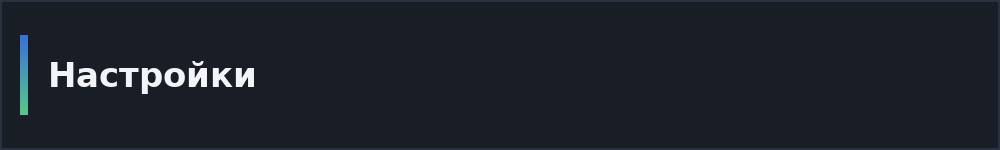

# 🎮 Chat&AutoAnimations RP Overhaul

[](https://github.com/Ven4esters/RP-Chat-Overlay/releases)
[](https://www.python.org/downloads/release/python-312/)


[](https://www.virustotal.com/gui/file/9a6c8da2e9472ee89ee3a6f6311844ed0a983d00327857a1749dc5782cc34749?nocache=1)


> Оверлей чата с переводом через DeepL/Google и автоматизация применения анимаций для ролевой игры (GTA 5).

<a id="содержание"></a>


## Содержание

- [О проекте](#о-проекте)
- [Возможности](#возможности)
- [Стек технологий](#стек-технологий)
- [Требования](#требования)
- [Установка](#установка)
- [Настройки](#настройки)
- [Режимы перевода и спецсимволы](#режимы-перевода-испецсимволы)
- [DeepLX в России](#deeplxвроссии)
- [Лицензия](#лицензия)
- [Контакты](#контакты)

<a id="о-проекте"></a>


Проект — оверлей для ролевого чата в GTA 5. Переводит входящие и исходящие
сообщения через DeepL (локальный сервис) или Google Translate, а также
автоматически применяет анимации персонажа по совпадению ключевых слов.
Язык интерфейса можно переключать между русским и английским без перезапуска.

<a id="возможности"></a>


- Перевод сообщений чата через DeepL или Google Translate
- Автоматический запуск анимаций по совпадению ключевых слов
- Встроенные глоссарии и раскрытие сленга на нескольких языках
- Управление локальным сервисом DLX (установка, запуск, остановка, прокси)
- Интерфейс на русском и английском языках

<a id="стек-технологий"></a>


Python 3.12 · PySide6 · deep-translator

<a id="требования"></a>


- Windows 10 / 11
- GTA 5
- Python ≥ 3.12 (для запуска из исходников)
- Подключение к интернету для сервисов перевода

<a id="установка"></a>


### Скомпилированный релиз (рекомендуется)

Скачайте последнюю сборку в [GitHub Releases](https://github.com/Ven4esters/RP-Chat-Overlay/releases):

| Файл | SHA-256 | MD5 | Размер |
|---|---|---|---|
| `RPChatOverlay.exe` | `9a6c8da2e9472ee89ee3a6f6311844ed0a983d00327857a1749dc5782cc34749` | `d854ac6a2c7d860ec59a5dd7acbc1a9e` | 47,7 MiB (49 990 457 байт) |

После скачивания проверьте контрольную сумму, затем запустите `RPChatOverlay.exe`.

### Из исходников

```bash
git clone https://github.com/Ven4esters/RP-Chat-Overlay.git
cd RP-Chat-Overlay
```

Запустите `source/start.bat` — он найдёт или установит Python 3.12, создаст
виртуальное окружение, установит зависимости и запустит приложение.

<a id="настройки"></a>


## Система модулей

Программа собрана из независимых модулей. Любой модуль можно выключить в
настройках — выключенный модуль не ломает остальное, программа продолжает
работать в урезанном виде. Если отключить модуль, от которого зависит другой,
зависимый тоже считается выключенным.

### Модули (по порядку в окне настроек)

| Модуль | Ключ в конфиге | По умолчанию | Назначение |
|---|---|---|---|
| Перевод по сети | `translator_enabled` | Вкл | Цепочка сервисов Google, MyMemory, Lingva и LibreTranslate. Без него работают только встроенные словари. |
| Словарь | `glossary_enabled` | Вкл | Готовые фразы с русской записью и значениями. Без него фразы переводятся сервисами, без подсказки «как читается». |
| Сленг и сокращения | `slang` | Вкл | `brb`, `afk`, `gg`, `спс`, `мб` раскрываются в полные фразы до перевода. |
| Автоперевод | `auto_mode` | Выкл | Каждое N-е сообщение переводится само. Требует перевода по сети. Работает только в частичном режиме. |
| Отправка в игру | `game_send` | Вкл | Оверлей сам открывает чат игры, вставляет текст и нажимает Enter. Если выключено — текст только копируется в буфер обмена. |
| DeepL рядом (DLX) | `dlx_enabled` | Выкл | Локальный сервис DeepL как первый переводчик. Требует согласия и около 15 МБ на диске. |
| Анимации | `anims_enabled` | Выкл | Ключевое слово в сообщении запускает `/anim` в игре; через заданное время уходит `/sa`. Требует отправки в игру. |
| Глобальная клавиша | `hotkey_enabled` | Вкл | Вызов оверлея из игры одной клавишей. Без него — двойным щелчком по значку в трее. |

### Переменные конфигурации

Настройки сохраняются в `data/config.json` рядом с исполняемым файлом.
Не добавляйте реальные ключи в репозиторий — они принадлежат только
локальной папке с данными.

#### Язык и направление

| Переменная | Обязательна | По умолчанию | Описание |
|---|---|---|---|
| `target_lang` | нет | `it` | Целевой язык перевода |
| `send_mode` | нет | `reading` | `reading` = русская запись, `native` = текст на языке |
| `mode` | нет | `partial` | Режим перевода: `full` | `partial` | `to_ru` |
| `direction` | нет | `out` | Устаревший дубль режима (`out` = русский → язык, `in` = язык → русский) |

#### Интерфейс

| Переменная | Обязательна | По умолчанию | Описание |
|---|---|---|---|
| `ui_lang` | нет | `ru` | Язык интерфейса (`ru` / `en`) |
| `ui_lang_chosen` | нет | `false` | Игрок уже выбирал язык |
| `show_settings_on_start` | нет | `true` | Показывать настройки при запуске |
| `setup_done` | нет | `false` | Первый запуск пройден |
| `ui_scale` | нет | `1.0` | Масштаб интерфейса |
| `always_on_top` | нет | `true` | Оверлей поверх игры |

#### Модули

| Переменная | Обязательна | По умолчанию | Описание |
|---|---|---|---|
| `translator_enabled` | нет | `true` | Перевод по сети |
| `glossary_enabled` | нет | `true` | Словарь |
| `hotkey_enabled` | нет | `true` | Глобальная клавиша |
| `dlx_enabled` | нет | `false` | DeepL рядом (DLX) |
| `dlx_asked` | нет | `false` | Предупреждение уже показано |
| `dlx_port` | нет | `0` | Порт сервиса, 0 — выбрать свободный |
| `dlx_autostart` | нет | `true` | Поднимать вместе с программой |
| `dlx_auto_update` | нет | `true` | Проверять обновления |
| `dlx_proxy` | нет | `` | HTTP-прокси для DeepL |
| `dlx_use_system_proxy` | нет | `true` | Брать прокси из настроек Windows |
| `dlx_url` | нет | `` | Свой адрес сервиса вместо dlx.exe |
| `dlx_url_token` | нет | `` | Токен своего сервиса |
| `dlx_pro_token` | нет | `` | Токен DeepL Pro (OAuth) |
| `slang` | нет | `true` | Сленг и сокращения |
| `slang_lang` | нет | `` | Язык таблицы сокращений |

#### Текст и маркеры

| Переменная | Обязательна | По умолчанию | Описание |
|---|---|---|---|
| `marker_open` | нет | `+` | Маркер «переведи это» |
| `marker_close` | нет | `+` | Маркер закрытия фрагмента |
| `max_chars` | нет | `256` | Предел длины сообщения |
| `debounce_ms` | нет | `450` | Пауза после ввода перед переводом |
| `filler_always` | нет | `true` | Слова-паразиты в каждом сообщении |

#### Автоперевод

| Переменная | Обязательна | По умолчанию | Описание |
|---|---|---|---|
| `auto_mode` | нет | `false` | Включён ли автоперевод |
| `auto_every` | нет | `4` | Каждое N-е сообщение |
| `auto_position` | нет | `last` | `last` | `first` | `random` | номер 1..N |
| `auto_fragments` | нет | `1` | Сколько фрагментов переводить |
| `auto_min_words` | нет | `1` | Длина фрагмента от |
| `auto_max_words` | нет | `3` | Длина фрагмента до |
| `auto_prefer_glossary` | нет | `true` | Сначала фразы из словаря |

#### Отправка в игру

| Переменная | Обязательна | По умолчанию | Описание |
|---|---|---|---|
| `game_send` | нет | `true` | Отправлять в игру |
| `game_press_enter` | нет | `false` | Нажимать Enter после вставки |
| `game_submit` | нет | `true` | Отправлять сообщение |
| `game_chat_key` | нет | `t` | Клавиша чата в игре |
| `game_open_chat_first` | нет | `true` | Сначала открыть чат игры |
| `game_open_delay_ms` | нет | `300` | Пауза после открытия чата |
| `game_paste_delay_ms` | нет | `150` | Пауза перед вставкой |
| `game_focus_delay_ms` | нет | `150` | Пауза перед возвратом фокуса |
| `game_input_mode` | нет | `paste` | `paste` = Ctrl+V, `type` = посимвольный ввод |
| `game_window_class` | нет | `grcWindow` | Класс окна игры |
| `game_extra_exes` | нет | `[]` | Дополнительные процессы игры |

#### Анимации

| Переменная | Обязательна | По умолчанию | Описание |
|---|---|---|---|
| `slang_order` | нет | `[]` | Свой порядок сокращений |
| `anims_enabled` | нет | `false` | Модуль «Анимации» |
| `anim_rules` | нет | `[]` | Правила: слово → `/anim` |
| `anim_stop_key` | нет | `f` | Клавиша остановки |
| `anim_stop_by_sa` | нет | `true` | Останавливать командой `/sa` |
| `anim_stop_by_key` | нет | `false` | Останавливать нажатием клавиши |
| `anim_skip_negation` | нет | `true` | Пропускать отрицание |
| `anim_extra_ms` | нет | `50` | Добавка к длительности анимации |
| `anim_in_vehicle` | нет | `false` | Режим «В машине» |

<a id="режимы-перевода-испецсимволы"></a>


Программа поддерживает несколько способов перевода и особые маркеры в тексте:

### Автоперевод

Каждое N-е сообщение переводится автоматически. Для команд `/to`, `/lto`, `/l`,
`/wt`, `/s`, `/st` автоперевод применяется как к обычным сообщениям.

### Форсированный перевод фрагмента `+...+`

Обёрните часть текста в `+` — фрагмент переведётся даже когда автоперевод
выключен. Например: `+`привет, брат`+` — всегда уйдёт в чат на целевом языке.

### Действия `*...*`

Текст в звёздочках воспринимается как действие персонажа и переводится целиком.
Служебные команды (`/me`, `/do`, `/to`) и никнеймы не переводятся.

### Слова-паразиты

Это filler-слова, которые вставляются в **каждое** сообщение независимо от
счётчика автоперевода: `Senti`, `Ma dai`, `Oye`, `那个` и другие. Включаются
галочкой у фразы в словаре.

### Приоритет Словаря над переводом

Если фраза есть во встроенном или пользовательском словаре, она переводится
согласно словарной записи (с русской записью «как это читается») и не уходит на
внешние сервисы перевода. Словарь имеет приоритет над сетевым переводом.

<a id="deeplxвроссии"></a>


С июня 2025 года DeepL закрыт для российских IP-адресов. Локальный сервис DLX
запускается, но DeepL возвращает ошибку `503` — состояние
**«Работает, но DeepL не отвечает (503)»**.

Как обойти: используйте **HTTP-прокси** (v2rayN, Clash, SOCKS5) или разверните
свой сервер DLX за рубежом ([подробная инструкция](docs/DEEPLX-RUSSIA.md)).
Если прокси нет — просто отключите DLX, программа вернётся к обычным
сервисам перевода без ограничений.

<a id="лицензия"></a>


[MIT](LICENSE)

<a id="контакты"></a>


- Автор: [Ven4esters](https://github.com/Ven4esters)
- Вопросы и предложения: [GitHub Issues](https://github.com/Ven4esters/RP-Chat-Overlay/issues)